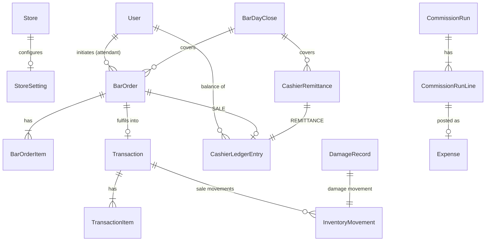

# Database Impact Analysis

> Bar / Lounge Mode planning · document 4 of 8
> **Nothing in this document has been executed.** No schema file was edited and no migration was created or run.

Design rules applied throughout (they match the house style already in `schema.prisma`):
- UUID string PKs. `store_id` is a plain string (not FK) for tenant isolation, plus a real FK to `Branch`.
- Money is `Decimal(15,2)`, quantities are `Decimal(15,4)`, statuses are documented `String`s (the schema has **zero Prisma enums**; keep it that way).
- **Strictly additive migrations:** `CREATE TABLE`, `ADD COLUMN … NULL` or `… DEFAULT`, `CREATE INDEX`. No renames, drops or type changes. This is the same discipline as the Phase 4B procurement migration.
- **Append-only financial tables:** no `updated_at` on ledger rows, and no code path that updates or deletes them.

---

## 1. Existing entities — reuse map

| Model | Reuse | Change? |
|---|---|---|
| `Store` | Holds business mode | **+1 column** |
| `StoreSetting` | Holds bar configuration | **+~9 columns** (all defaulted / nullable) |
| `User` | Attendants and controllers stay `role='cashier'` | **+1 column** `operational_profile` |
| `Branch`, `Category`, `Product`, `Location`, `Inventory`, `BatchTracking` | As-is | none (`Inventory.quantity_reserved` already exists, unused; it is available for decision D5) |
| `Transaction` | **The completed bar sale.** `user_id` = attendant | **+3 nullable columns** |
| `TransactionItem` | As-is (lines of the completed sale, with cost snapshot) | none |
| `InventoryMovement` | Ledger for fulfilment (`sale`), reversal (`adjustment`) and damage (**new value `damage`**) | none (string column; new value only) |
| `AuditLog` | Every bar event | none |
| `ExpenseCategory` / `Expense` | Commission expense | **+2 nullable columns** on `Expense` (source link) |
| `CashShift` | Optional: attendants/controllers may still open shifts; not relied on for bar money | none |
| `Customer` / `Payment` | Optional customer on a bar order; not used for attendant balances | none |
| `DailyAnalytics` | Unused today; not needed | none |
| `OfflineSyncQueue` | Not used | none |

---

## 2. Proposed column additions (existing tables)

```prisma
model Store {
  // ...existing...
  business_mode         String    @default("retail") // retail | bar
  business_mode_set_at  DateTime?                   // audit convenience
}

model StoreSetting {
  // ...existing...
  // Bar / Lounge
  bar_business_day_cutoff_hour  Int      @default(6)    // 0–23; a sale at 02:00 belongs to the previous business day
  bar_timezone                  String   @default("Africa/Lagos")
  // (D24 approved: damage is always a house loss → no damage charge policy column)
  bar_attendant_discount        Boolean  @default(false)
  bar_allow_backdated_remittance Boolean @default(false)  // controller back-dating; managers always may
  bar_require_payment_declaration Boolean @default(false)
  // Commission
  commission_enabled            Boolean  @default(false)
  commission_rate               Decimal? @db.Decimal(5, 2) // percent
  commission_basis              String   @default("total_sales") // D27 approved: Σ fulfilled total_amount; column kept for future bases
}

model User {
  // ...existing...
  operational_profile String? // null | bar_controller | bar_attendant
  @@index([store_id, operational_profile])
}

model Transaction {
  // ...existing...
  sales_order_id        String?  @unique  // set only for bar-mode sales
  fulfilled_by_user_id  String?           // controller who released & posted
  business_date         DateTime? @db.Date // bar sales only; computed with cutoff + tz
  @@index([business_date])
}

model Expense {
  // ...existing...
  source_type String?   // e.g. "commission_run_line"
  source_id   String?
  @@unique([source_type, source_id])  // NULLs don't collide in Postgres → retail rows unaffected
}
```

Notes:
- `Transaction.sales_order_id @unique` is the **database-level guarantee** that one order can never produce two sales, even if fulfilment is double-clicked or retried.
- `business_date` on `Transaction` is nullable. Retail never sets it, so retail reports are unchanged. Bar reports group by it. Decision D4 covers whether to backfill it for retail later.
- Postgres treats `NULL`s as distinct in unique indexes, so the `Expense` unique constraint has no effect on existing rows.

---

## 3. New tables

### 3.1 `BarOrder` / `BarOrderItem` (pending orders, kept out of `Transaction`)

```prisma
model BarOrder {
  id                    String    @id @default(uuid())
  store_id              String
  branch_id             String
  order_number          String              // human ref, e.g. B-20261117-0142
  client_ref            String    @unique   // idempotency key from the submitting device
  status                String    @default("submitted") // submitted | accepted | fulfilled | cancelled | rejected | reversal_requested | reversed
  initiated_by_user_id  String              // attendant — the seller of record
  accepted_by_user_id   String?
  fulfilled_by_user_id  String?
  customer_id           String?
  table_label           String?
  subtotal              Decimal   @db.Decimal(15, 2)  // server-computed at submit
  tax_amount            Decimal   @db.Decimal(15, 2)
  discount_amount       Decimal   @default(0) @db.Decimal(15, 2)
  total_amount          Decimal   @db.Decimal(15, 2)
  fulfilled_total       Decimal?  @db.Decimal(15, 2)  // after any reductions
  customer_payment_method String?             // cash | transfer | card | split | null (undeclared)
  customer_payment_splits Json?
  customer_payment_ref    String?
  transaction_id        String?   @unique     // the completed sale
  business_date         DateTime? @db.Date    // set at fulfilment
  submitted_at          DateTime  @default(now())
  accepted_at           DateTime?
  fulfilled_at          DateTime?
  closed_reason         String?               // cancel / reject / reversal reason
  closed_by_user_id     String?
  closed_at             DateTime?
  day_close_id          String?               // set when included in a day close
  created_at            DateTime  @default(now())
  updated_at            DateTime  @updatedAt

  items BarOrderItem[]
  @@unique([store_id, order_number])
  @@index([store_id, branch_id, status])
  @@index([initiated_by_user_id, status])
  @@index([business_date])
}

model BarOrderItem {
  id                 String  @id @default(uuid())
  bar_order_id       String
  product_id         String
  quantity_requested Decimal @db.Decimal(15, 4)
  quantity_fulfilled Decimal? @db.Decimal(15, 4)   // ≤ requested; null until fulfilment
  unit_price         Decimal @db.Decimal(12, 2)    // snapshot at submit
  tax_rate           Decimal @db.Decimal(5, 2)     // snapshot
  line_total         Decimal @db.Decimal(15, 2)
  reduction_reason   String?
  @@index([bar_order_id])
  @@index([product_id])
}
```
The order row is **mutable only through its state machine** (status + timestamps + fulfilled quantities). After `fulfilled`, it is frozen apart from the payment declaration (until day close) and the reversal fields.

### 3.2 `CashierLedgerEntry` (append-only; the heart of carry-forward)

```prisma
model CashierLedgerEntry {
  id               String   @id @default(uuid())
  store_id         String
  branch_id        String
  cashier_user_id  String            // the attendant whose balance this moves
  entry_type       String            // SALE | SALE_REVERSAL | REMITTANCE | REMITTANCE_REVERSAL | WRITE_OFF | ADJUSTMENT  (no DAMAGE_CHARGE — D24)
  amount           Decimal  @db.Decimal(15, 2)  // signed: + increases what the attendant owes
  business_date    DateTime @db.Date
  source_type      String            // bar_order | remittance | damage | write_off | adjustment
  source_id        String
  reverses_entry_id String?  @unique  // a reversal points at exactly one original → cannot reverse twice
  reason           String?
  recorded_by_user_id String
  created_at       DateTime @default(now())

  @@unique([entry_type, source_type, source_id]) // one SALE per order, one REMITTANCE per remittance, ...
  @@index([store_id, cashier_user_id, business_date])
  @@index([business_date])
}
```
Balances:
- `outstanding(cashier) = Σ amount`
- `opening(cashier, D) = Σ amount WHERE business_date < D`
- the day's movement = Σ by `entry_type` for `business_date = D`
- `closing = opening + day movement`

These are cheap queries with the composite index. If volume ever demands it, add a nightly snapshot table; it is not needed at launch.

### 3.3 `CashierRemittance`

```prisma
model CashierRemittance {
  id                  String   @id @default(uuid())
  store_id            String
  branch_id           String
  cashier_user_id     String            // attendant paying in
  received_by_user_id String            // controller / manager
  amount              Decimal  @db.Decimal(15, 2)  // > 0
  method              String            // cash | transfer | card | other
  reference           String?           // mandatory for transfer/card (enforced in service)
  narration           String?
  business_date       DateTime @db.Date
  client_ref          String   @unique  // idempotency (double-tap safety)
  status              String   @default("recorded") // recorded | reversed
  reversed_by_user_id String?
  reversed_at         DateTime?
  reversal_reason     String?
  day_close_id        String?
  created_at          DateTime @default(now())

  @@index([store_id, cashier_user_id, business_date])
  @@index([store_id, method, reference]) // duplicate-reference detection
}
```

### 3.4 `DamageRecord`

```prisma
model DamageRecord {
  id                   String   @id @default(uuid())
  store_id             String
  branch_id            String
  product_id           String
  quantity             Decimal  @db.Decimal(15, 4)
  reason_code          String           // flat | broken | bad_cap | expired | other
  notes                String?
  responsible_user_id  String?          // attendant involved (analytics only — never charged, D24), or null
  recorded_by_user_id  String
  unit_cost            Decimal? @db.Decimal(12, 2)  // snapshot of cost_price → loss value at cost
  unit_price           Decimal  @db.Decimal(12, 2)  // snapshot of selling price → lost-sales value
  business_date        DateTime @db.Date
  client_ref           String   @unique
  status               String   @default("recorded") // recorded | reversed
  reversed_by_user_id  String?
  reversed_at          DateTime?
  reversal_reason      String?
  created_at           DateTime @default(now())

  @@index([store_id, business_date])
  @@index([responsible_user_id])
  @@index([product_id])
}
```
Each record writes one `InventoryMovement` (`movement_type='damage'`, `quantity=-qty`, `reference_id=DamageRecord.id`). A reversal writes a `+qty` `adjustment` movement. The P&L shows damage at cost as a stock loss. It **never** touches the cashier ledger.

### 3.5 `BarDayClose` (+ handover)

```prisma
model BarDayClose {
  id                    String   @id @default(uuid())
  store_id              String
  branch_id             String
  business_date         DateTime @db.Date
  status                String   @default("submitted") // submitted | acknowledged | reopened
  closed_by_user_id     String            // controller
  snapshot              Json              // frozen per-attendant + totals figures
  expected_cash         Decimal  @db.Decimal(15, 2)
  counted_cash          Decimal  @db.Decimal(15, 2)
  expected_transfer     Decimal  @db.Decimal(15, 2)
  expected_card         Decimal  @db.Decimal(15, 2)
  variance              Decimal  @db.Decimal(15, 2)
  variance_reason       String?
  acknowledged_by_user_id String?
  acknowledged_amount   Decimal? @db.Decimal(15, 2)
  acknowledged_at       DateTime?
  ack_note              String?
  created_at            DateTime @default(now())

  @@unique([branch_id, business_date, closed_by_user_id])  // D11 approved: one close per Bar Controller per business day
  @@index([store_id, business_date])
}
```
Each controller's close covers only the remittances **they** received and the orders **they** fulfilled. The manager's handover inbox lists every controller's close for the day. The branch-day total is the sum of those closes.

### 3.6 `CommissionRun` / `CommissionRunLine`

```prisma
model CommissionRun {
  id                 String   @id @default(uuid())
  store_id           String
  branch_id          String?
  period_start       DateTime @db.Date
  period_end         DateTime @db.Date
  rate               Decimal  @db.Decimal(5, 2)   // snapshot
  basis              String                        // snapshot
  status             String   @default("draft")    // draft | posted | cancelled
  created_by_user_id String
  posted_by_user_id  String?
  posted_at          DateTime?
  created_at         DateTime @default(now())
  lines CommissionRunLine[]
}

model CommissionRunLine {
  id                 String   @id @default(uuid())
  commission_run_id  String
  cashier_user_id    String
  period_start       DateTime @db.Date   // denormalised for the overlap guard
  period_end         DateTime @db.Date
  eligible_sales     Decimal  @db.Decimal(15, 2)
  deductions         Decimal  @default(0) @db.Decimal(15, 2)
  commission_amount  Decimal  @db.Decimal(15, 2)
  expense_id         String?  @unique   // set when posted
  payment_status     String   @default("unpaid") // unpaid | paid
  paid_at            DateTime?
  paid_method        String?
  paid_reference     String?
  @@index([cashier_user_id, period_start, period_end])
}
```
**Duplicate-commission prevention** has three layers:
1. The service rejects posting a line whose `[period_start, period_end]` overlaps any **posted** line for the same cashier.
2. `Expense @@unique([source_type, source_id])` with `source_type='commission_run_line'`.
3. `CommissionRunLine.expense_id @unique`.

Optionally (layer 4), a Postgres `EXCLUDE USING gist` constraint on date ranges. Prisma can't express it, but a raw-SQL migration can. Recommended, but optional.

---

## 4. Entity relationships (new parts)



---

## 5. Migration considerations

| Concern | Assessment |
|---|---|
| **Backward compatibility** | All existing rows remain valid: new columns are nullable or defaulted, `business_mode` defaults to `retail`, and no existing query changes meaning. Retail clients that don't know the new fields ignore them. |
| **Old mobile app versions in the field** | They never call `/v1/bar/*`. If an old app logs into a bar store as an attendant, it would show retail checkout. **Mitigation:** the server blocks `POST /transactions` for `bar_attendant` in bar stores (Phase 0/1 guard), and `/auth/me` returns a `min_client_version` hint. |
| **Migration size and locking** | `ADD COLUMN` with a constant default is metadata-only on Postgres ≥ 11, so it is fast even on a large `Transaction` table. New indexes on `Transaction(business_date)` should be created `CONCURRENTLY` in production (raw SQL step). |
| **Production schema drift (known risk)** | Prod has already suffered drift (`TransactionItem.cost_price`, Nov 2026). `ServiceComponent` and the expenses migration (`20261116…`) are **untracked/unapplied** in git right now. **The bar migration must not be generated until the outstanding migrations are committed and applied to prod**, or the new migration will bundle unrelated changes. Run `prisma migrate diff` against prod before deploying. |
| **Rollback** | Purely additive, so rollback = deploy the previous backend build. The extra tables and columns are harmless if unused. No down-migration is required. |
| **SQLite local-mode** | New tables use one `Json` column each (`BarDayClose.snapshot`, `BarOrder.customer_payment_splits`), which adds to the existing SQLite portability list. Alternatively store them as `String` holding JSON from day one. Recommended: use `String` for these new fields to avoid adding to that debt. |
| **Data volume** | A busy bar: ~500 orders/day → 500 orders + ~1,500 items + ~600 ledger rows per day. That is trivial for Postgres with the listed indexes. |
| **Test data** | Seed script additions for a bar demo store, created only in dev/test. |
