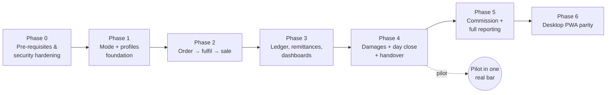

# Implementation Roadmap

> Bar / Lounge Mode planning · document 7 of 8
> **Nothing below has started.** Per CLAUDE.md §2 and brief §29: each phase ends with green gates and a **STOP for approval** before the next.

Standing gates for every phase:
- backend `npm run build` plus the hermetic unit suites
- shared vitest
- mobile tests 20/20
- desktop typecheck and build
- new unit tests for everything added

Live end-to-end scenarios are run against a local backend with a seeded bar demo store.

---

## ⚠️ Mobile first (decision D7, approved 2026‑11‑17)

The client work in Phases 1–5 is built in the **Expo mobile app** (`mobile/`). In the phase tables below, read every **"Client"** row as mobile screens. Desktop parity is **Phase 6**. The backend work is identical either way.

Mobile-specific constraints that apply:
- Bar flow is **online-only** on mobile, too. It must not go through the AsyncStorage offline queue. Orders, remittances and closes are plain API calls with `client_ref` idempotency, and show a clear "no connection" state.
- Polling uses a focused-screen interval (pause when the app is backgrounded, to save battery and data).
- Mobile consumes `@jaypos/shared` through Metro `extraNodeModules`. The bar types and capability helpers go in `shared/`, so desktop reuses them later.
- Gates: mobile `jest-expo` cannot boot in the build sandbox, and mobile `tsc` has pre-existing vector-icon errors. Bar logic is therefore kept in pure, testable modules (shared vitest), and the RN screens are verified on a device or emulator against a local backend.
- Navigation: the bar screens join `ROLE_TABS` in `mobile/src/App.tsx` through a **mode + profile** predicate. Attendants in a bar store do not see the retail Checkout.

## Phase overview

The minimum viable bar is **P0 → P4**, on the mobile app. A pilot bar can go live after P4. P5 adds commission and the full report set. P6 brings the same screens to the desktop PWA.

---

## Phase 0 — Prerequisites & hardening (no bar features)

**Goal:** remove the existing gaps that would undermine bar-mode controls, and get the migration baseline clean.

| Task | Notes |
|---|---|
| Commit and apply the outstanding migrations (`20261106…cost_price`, `20261116…expenses_and_service_components`) and re-verify prod has no drift (`prisma migrate diff`) | Blocks every later migration. |
| Scope `GET /v1/transactions` so a `cashier` sees only their own rows (or as decided), and add a store check to `GET /v1/transactions/:id` | Risks R1, R2. **D1 approved: all stores.** This changes current retail cashier behaviour, so mobile and desktop history screens must be checked to confirm they handle the narrower list. |
| Gate `POST /v1/transactions/:id/void` to admin/manager plus a store check | Risk R3. **D1: all stores.** Hide the Void action for cashiers in mobile and desktop. |
| Add `store_id`/`branch_id` to void/refund audit rows | Risk R6. Purely additive fix. |
| Extract `TransactionService.createTransaction` posting core into `postSale(tx, input)` **with zero behaviour change**, plus the guarded stock decrement | Retail regression tests: idempotency, stock, service components, customer stats, discount audit. |
| Timezone/business-date helper (pure, unit-tested) | Used by every later phase. |

**Exit:** all existing tests green, plus new tests for R1/R2/R3/R6 and `postSale` parity. **Risk:** medium (it touches the sales core). **Effort:** ~3–4 dev-days.

---

## Phase 1 — Business mode & operational profiles

| Layer | Work |
|---|---|
| DB (additive migration #1) | `Store.business_mode`, `User.operational_profile`, `StoreSetting` bar + commission columns. |
| Backend | `requireBusinessMode`, `capabilities.ts` + `requireCapability`. `business_mode` + `operational_profile` in JWT and `/auth/me`. Mode-lock rules on change. Profile assignment in `/auth/users` (admin). Guard: attendants are blocked from retail `POST /transactions` in bar stores. |
| Super-admin wizard | Mode selector on store creation. |
| Client (mobile first) | Settings → "Business mode" (admin, locked after the first sale) and "Bar settings" tab. Users page: profile dropdown (bar stores only). `nav.ts` mode/profile-aware visibility. Empty bar landing pages. |
| Shared | `BusinessMode`, `OperationalProfile` types, and capability helper (pure) used by desktop (and later mobile). |

**Tests:** mode-lock rules; capability map truth-table tests (each role × profile × mode); retail store sees zero change (snapshot of nav and API responses). **Exit:** a bar store can be created and users profiled, and a retail store is byte-identical in behaviour. **Effort:** ~3 dev-days.

---

## Phase 2 — Orders → fulfilment → sale (the core loop)

| Layer | Work |
|---|---|
| DB (migration #2) | `BarOrder`, `BarOrderItem`. `Transaction.sales_order_id @unique`, `fulfilled_by_user_id`, `business_date`. `InventoryMovement` value `damage` reserved (no DDL). |
| Backend | `BarOrderService`: submit (server pricing, `client_ref` idempotency), cancel, accept/release claim, reject, fulfil (reduce qty, call `postSale` with attendant attribution, same DB transaction), payment declaration. Queue + my-orders endpoints with strict scoping. |
| Client (mobile first) | Attendant: `/bar/orders/new` (product grid reusing the existing POS product search components), `/bar/my-orders` (10 s poll). Controller: `/bar/queue` (5 s poll), order detail with reduce/reject/fulfil, optional printable release slip (browser print). |

**Tests:** state-machine transitions incl. illegal ones; double-fulfil race (concurrent calls → exactly one Transaction); stock guard; attribution (Transaction.user_id = attendant even though the controller posts); a forged `user_id` in the body is ignored; attendant cannot read another attendant's orders; retail reports count bar sales correctly by attendant. **Effort:** ~6–8 dev-days.

---

## Phase 3 — Cashier ledger, remittances, dashboards

| Layer | Work |
|---|---|
| DB (migration #3) | `CashierLedgerEntry`, `CashierRemittance`. |
| Backend | `CashierLedgerService` (append, reverse, balances: outstanding / opening / day movement / closing / aged). Fulfilment now also appends `SALE` (backfill for Phase-2 pilot data via an idempotent script). `RemittanceService` (record, reverse, duplicate-reference warning, back-date rules). Write-off and adjustment (manager/admin). Overpayment policy per D21. |
| Client (mobile first) | Attendant dashboard `/bar/me`: KPIs (Total sales, Remitted, Outstanding split b/f vs today, Pending, Completed), payment mix, history tabs. Controller dashboard `/bar`: day totals, per-attendant table, pending, payment mix. `/bar/cashiers/[id]` reconciliation. `/bar/remittances` with receipt print. |

**Tests:** the carry-forward scenario from the brief (₦250k sales, ₦200k remitted → ₦50k b/f next day, then additional remittance); reversal can't be applied twice; closed-day protection placeholder; attendant isolation on every endpoint. **Effort:** ~6 dev-days.

---

## Phase 4 — Damages, day close, management handover  → **pilot-ready**

| Layer | Work |
|---|---|
| DB (migration #4) | `DamageRecord`, `BarDayClose`. Link columns `day_close_id` on orders and remittances (added in their tables' migration, nullable). |
| Backend | `DamageService` (stock −, `damage` movement, house loss with no ledger effect (D24), reversal). `DayCloseService` (pre-checks for pending orders, snapshot, counted vs expected per method, variance, submit, acknowledge, reopen; closed-period enforcement on all bar writes). |
| Client (mobile first) | `/bar/damages` (record + list). `/bar/day-close` wizard plus printable / CSV summary. Manager "Handover inbox" to acknowledge. |

**Tests:** damage never creates revenue; damage cannot drive stock negative; damage never changes an attendant balance; one close per controller per business day (D11); close blocks with pending orders; writes into a closed day rejected; reopen audited. **Live E2E pilot script** (full day: 3 attendants, 1 controller, partial fulfilment, a cancel, a reversal, flat beer, overpayment, transfer remittance, day close, manager acknowledgement, next-day b/f). **Effort:** ~6 dev-days.

---

## Phase 5 — Commission & complete reporting

| Layer | Work |
|---|---|
| DB (migration #5) | `CommissionRun`, `CommissionRunLine`. `Expense.source_type/source_id` + unique. Optional raw-SQL range-exclusion constraint. |
| Backend | `CommissionService` (compute on the attendant's total sales (D27), draft, approve/post → Expense in a system-managed "Cashier Commission" category per branch, mark paid, negative adjustments for later reversals). Report endpoints 1–10 with business-date filters + CSV. |
| Client (mobile first) | `/bar/commission` (runs, lines, post, pay). `/bar/reports/*` (10 reports, reusing the existing report shell, CSV export, print). P&L picks up commission automatically. |

**Tests:** the brief's commission example (5% × ₦200k = ₦10k); overlapping run rejected; double-post blocked at the DB level; a reversal after posting produces an adjustment in the next run; P&L includes commission exactly once. **Effort:** ~6–7 dev-days.

---

## Phase 6 — Desktop PWA parity

The same Attendant and Bar Controller screens in `desktop/` (Next.js) against the same `/v1/bar/*` API: `/bar/orders/new`, `/bar/my-orders`, `/bar/me`, `/bar/queue`, `/bar/cashiers/[id]`, `/bar/remittances`, `/bar/damages`, `/bar/day-close`, `/bar/commission`, `/bar/reports/*`. Reuses the shared capability helpers and types, the existing POS product search, and the report shell. `nav.ts` and `lib/roles.ts` become mode- and profile-aware. **Effort:** ~6–8 dev-days.

---

## Cross-cutting

| Topic | Plan |
|---|---|
| **Feature flag** | `business_mode` is the flag. Optionally also `SubscriptionPlan.features.bar_mode` to sell it as a plan feature (D6). |
| **Deployment** | Follow `DEPLOY_2026-11.md`: back up the DB, `prisma migrate deploy`, verify with `migrate diff`, deploy the backend, then the desktop. One migration per phase keeps each deploy small. |
| **Rollback** | Additive schema, so redeploying the previous build is enough. Bar tables are left dormant. |
| **Documentation** | One `BAR_MODE.md` as-built doc (endpoints, decisions, caveats), plus a CLAUDE.md status update, after each phase. User Guide chapter after Phase 4. |
| **Training material** | Printable one-pagers for attendants and controllers after the pilot. |
| **Total estimate** | P0–P4 (pilot-ready, mobile): **~28–32 dev-days**. React Native screens and device testing cost more than the desktop equivalents, and there is no automated RN test harness in the sandbox. P5: +7–8. P6 (desktop): +6–8. Estimates assume decisions are made up front. Each open decision left to mid-build adds rework. |
