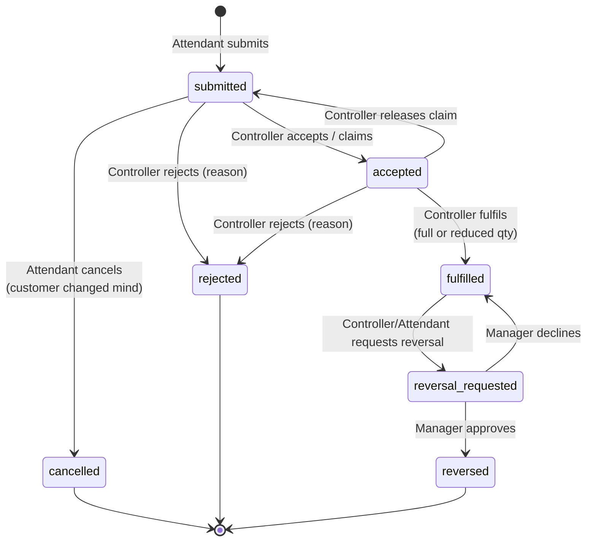
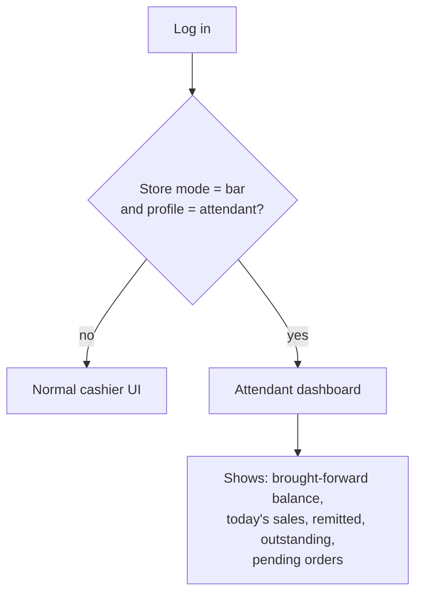
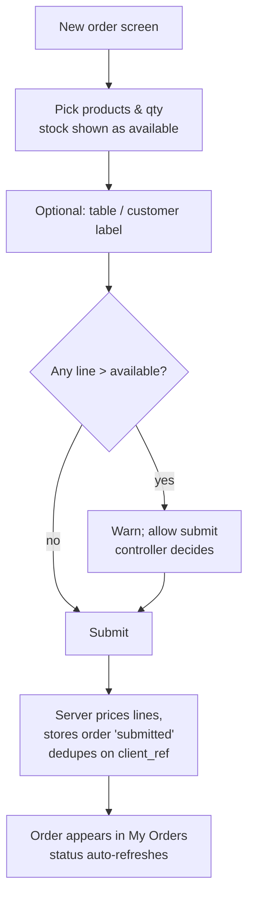
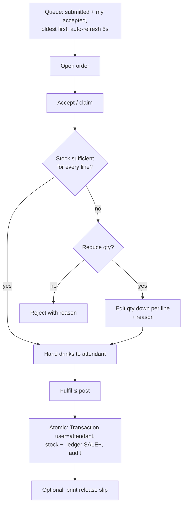
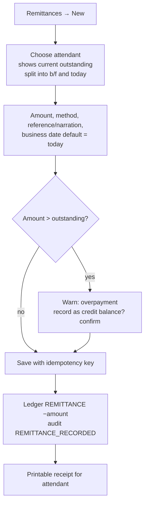
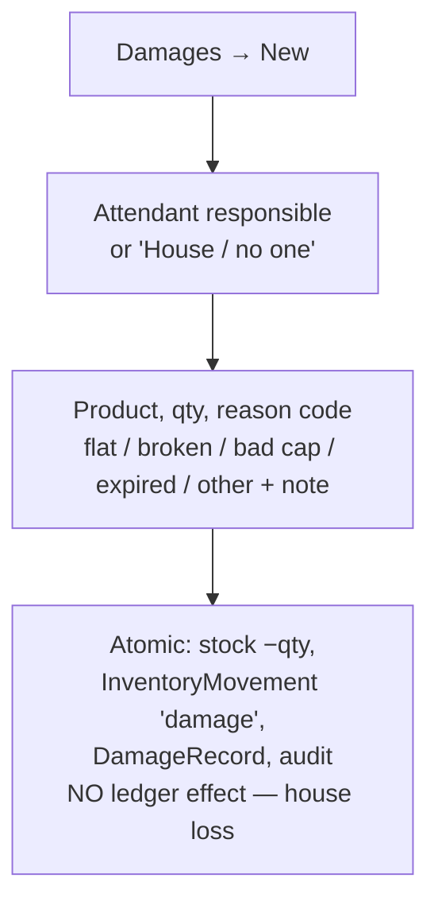
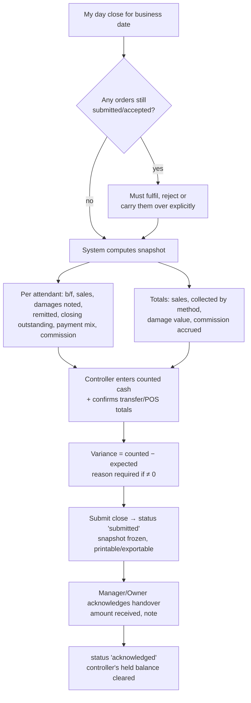
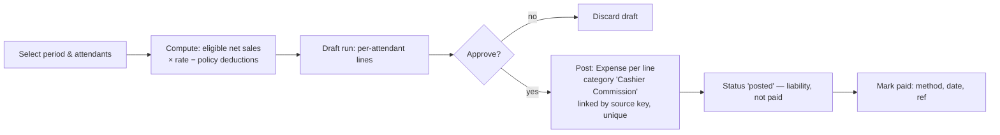

# Workflow Design — Bar / Lounge Mode

> Bar / Lounge Mode planning · document 3 of 8
> Terminology used in all docs: **Cashier One = Bar Controller** (`bar_controller`), **Cashier Two = Attendant** (`bar_attendant`). "Manager" means `role = manager`; "Owner" means `role = admin`.

---

## 1. The end-to-end picture

```mermaid
sequenceDiagram
  autonumber
  actor Cust as Customer
  actor C2 as Attendant (Cashier Two)
  participant API as JayPOS /v1/bar
  actor C1 as Controller (Cashier One)
  actor Mgr as Manager / Owner

  Cust->>C2: "2 Goldberg, 1 Hero, 2 water"
  C2->>API: Submit order (lines + client_ref)
  API-->>C2: Order #B-0142 · submitted · server-priced total
  C1->>API: Poll queue → sees #B-0142
  C1->>API: Accept (claims the order)
  C1->>C2: Physically hands over the drinks
  C1->>API: Fulfil (optionally reduce qty with reason)
  Note over API: ONE DB transaction:<br/>order→fulfilled, Transaction(user=C2),<br/>stock −, sale movements,<br/>ledger SALE +₦ for C2, audit
  C2->>Cust: Serves; collects ₦ (cash / transfer / POS)
  C2->>API: Declares customer payment method on the order
  C2->>C1: Hands over cash later in the shift
  C1->>API: Record remittance (C2, ₦, method, ref)
  Note over API: ledger REMITTANCE −₦ for C2
  C1->>API: Day close → reconciliation snapshot
  C1->>Mgr: Hands over day's collections
  Mgr->>API: Acknowledge handover (amount counted)
```

---

## 2. Bar order lifecycle



| State | Stock | Revenue (`Transaction`) | Attendant ledger | Who can move it |
|---|---|---|---|---|
| `submitted` | untouched (optionally reserved, decision D5) | none | none | Attendant (cancel), Controller (accept/reject) |
| `accepted` | untouched | none | none | Controller who claimed it, or Manager |
| `fulfilled` | **deducted** | **1 completed Transaction, `user_id = Attendant`** | **SALE +total** | Manager only (reversal) |
| `cancelled` / `rejected` | untouched | none | none | terminal |
| `reversed` | **restored** (adjustment movements) | Transaction → `voided` with reason | **SALE_REVERSAL −total** | terminal |

Key rules:
- **Only `fulfilled` creates money or stock effects.** Cancelling or rejecting a not-yet-fulfilled order can never double-count or leave stock out.
- `accepted` exists so two controllers on the same shift don't both pour the same order. The claim is a row-level check on accept/fulfil (`WHERE status='submitted'` / `accepted_by = me`).
- A fulfilled order is **never edited**. Corrections are a reversal plus a new order.

---

## 3. Attendant (Cashier Two) workflows

### 3.1 Start of day

The **brought-forward balance** is shown prominently and separately ("You owe ₦50,000 from previous days"), so it is never confused with today's figures.

### 3.2 Take and submit an order

- The price is fixed **at submission** (snapshot) from `Product.effective_price` / `tax_rate`, server-side. A price change after submission does not alter an already-submitted order. Decision D8 covers whether to re-price at fulfilment instead.
- Discounts: **off by default for attendants in bar mode** (decision D9). If they are enabled, they are applied at submission and visible to the controller.

### 3.3 Cancel an order
Allowed only while `submitted`, by the attendant who created it (or Controller/Manager). A reason is mandatory and the cancellation is audited.

### 3.4 Declare how the customer paid
On a fulfilled order, the attendant sets `customer_payment_method` (cash / transfer / POS(card) / split with amounts) and an optional reference (transfer narration, POS slip number).
- This drives the **attendant payment-mix** KPI.
- It does **not** reduce what the attendant owes. Only a remittance recorded by the controller does that.
- Editable by the attendant until the order is included in a day-close. After that, only a Manager can change it.

### 3.5 View own records
`/bar/me` dashboard and `/bar/my-orders`, `/bar/my-ledger`. Every query is server-scoped to `initiated_by_user_id = me`. There is no `userId` parameter, so there is nothing to tamper with.

---

## 4. Controller (Cashier One) workflows

### 4.1 Fulfilment queue

- **Partial fulfilment:** quantities can only go **down**, never up. A line can go to 0. The unfulfilled remainder is dropped (no back-order). Original and fulfilled quantities are both kept on the order line. If the customer wants the rest later, it is a new order.
- **Stock re-check happens inside the posting DB transaction**, with a guarded decrement. If stock ran out between screen load and click, fulfilment fails cleanly and nothing is half-posted.

### 4.2 Record a remittance

- Several remittances per attendant per day are allowed.
- Remittances are **never edited or deleted**. A mistake is fixed with a `REMITTANCE_REVERSAL` (Controller within the same business day before day close; Manager afterwards), followed by a correct remittance.
- **Transfer received directly by the store account:** the controller verifies the bank alert, then records a remittance with method `transfer` and the bank reference. A reference is mandatory for transfer and POS methods, which makes duplicate detection possible.

### 4.3 Record damaged / flat beer

Per D24, flat or damaged beer is always a **house loss**. Naming the attendant is for analytics only.
Damage is **never** a sale. It creates no `Transaction`, so it never appears in revenue, but it does appear in the stock ledger and the damage report.

### 4.4 Daily close and handover to management
Per D11, **each Bar Controller closes their own day**. Their close covers the remittances they received and the orders they fulfilled. A manager acknowledges each controller's handover separately.

- The close is a **frozen snapshot plus a link to the ledger entries it covers**. It does not reset anything. Outstanding attendant balances simply stay in the ledger and appear as "brought forward" tomorrow.
- **Net amount available for remittance to management** = remittances received by the controller during the business day (by method) − any cash paid out by the controller that day (only if decision D12 allows paying commission or petty expenses from the till). Note that **transfers and POS** usually land in the bank already, so the physical handover is the **cash** line. The others are confirmed, not handed over.

---

## 5. Manager / Owner workflows

| Workflow | Summary |
|---|---|
| **Store setup** | Super-admin creates the store with `business_mode = bar` (or the admin picks Bar in Settings before the first sale). The admin creates users and sets each one's operational profile. |
| **Configure** | Settings → Bar: business-day cut-off hour, damage charging policy, commission (on/off, rate, basis), discounts for attendants, whether controllers may back-date remittances. |
| **Supervise live** | The manager can open the controller queue and do anything a controller can (fulfil, remit, record damage). |
| **Approve reversals** | Reversal requests on fulfilled orders, remittance reversals after day close, write-offs, and ledger adjustments are manager or owner only. |
| **Acknowledge day close** | Receives the controller's handover. Counted amount vs. expected, with variance noted. |
| **Commission run** | Select period → system computes commission per attendant → review → approve → **post** (creates one Expense per attendant per run) → later mark **paid**. |
| **Staff exit** | Deactivate the attendant. Any outstanding balance stays and must be **collected** (remittance) or **written off** (manager, reason). The report flags inactive users with non-zero balances. |
| **Reports** | See §6. |

### 5.1 Commission run

A period that overlaps an already-posted run for the same attendant is **rejected**. This is how duplicate commission expenses are prevented.

---

## 6. Reporting map

| # | Report | Primary source | Audience |
|---|---|---|---|
| 1 | Daily sales | existing `Transaction` (completed) + bar order link | Mgr/Owner, Controller |
| 2 | Sales by attendant | `Transaction.user_id` (already how employee report works) | Mgr/Owner, Controller |
| 3 | Controller fulfilment report | `BarOrder.fulfilled_by`, timings, reductions, rejections | Mgr/Owner |
| 4 | Remittance report | `CashierRemittance` | Mgr/Owner, Controller |
| 5 | Outstanding balances (aged) | `CashierLedgerEntry` Σ, bucketed by age | Mgr/Owner, Controller |
| 6 | Payment method breakdown | customer-declared (orders) **vs.** received (remittances), side by side | Mgr/Owner, Controller |
| 7 | Damaged / flat beer | `DamageRecord` (+ cost & retail value) | Mgr/Owner |
| 8 | Commission | `CommissionRun` / lines | Mgr/Owner |
| 9 | Daily management remittance | `BarDayClose` + acknowledgement | Mgr/Owner |
| 10 | Inventory adjustment | existing `InventoryMovement` filtered to `damage`, `adjustment` | Mgr/Owner |

All reports take a date range expressed as **business dates** and export CSV / print. The desktop already has CSV + print helpers in `/reports/*`, which will be reused.
